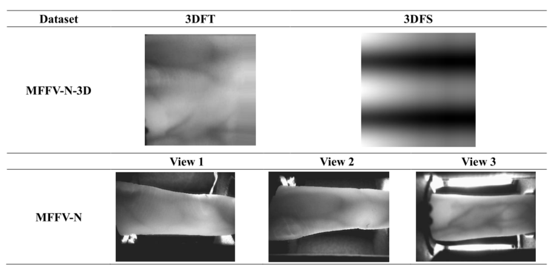
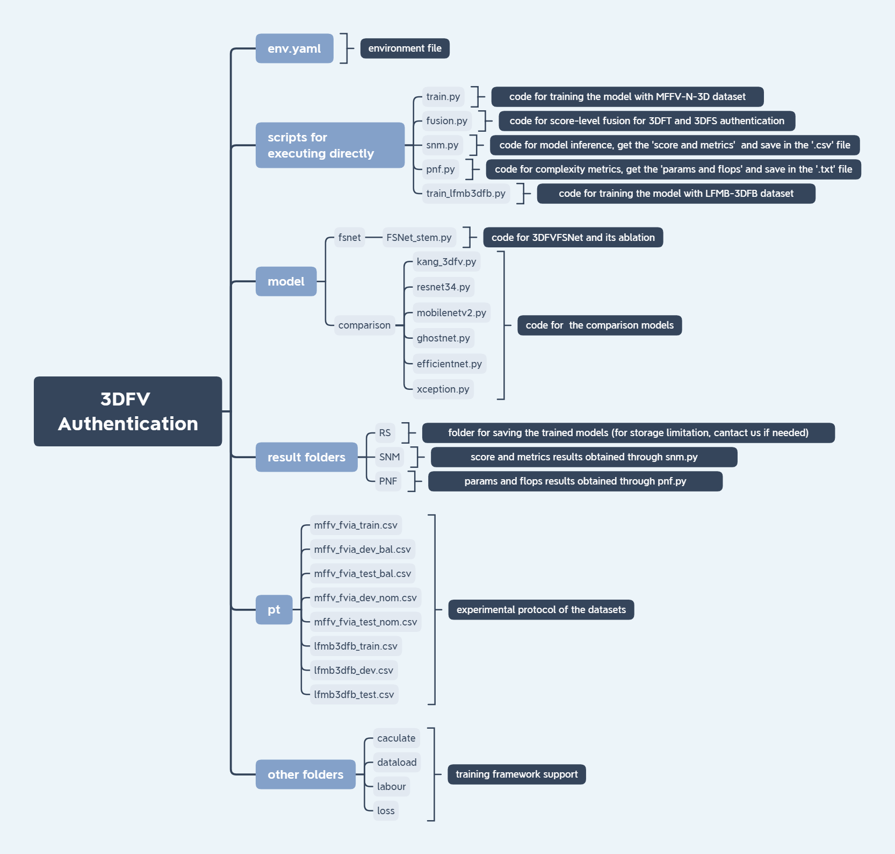

# Note:

**This repository was originally developed at the SCUT BIPLab (<https://github.com/SCUT-BIP-Lab/MFFV3D>)**

# MFFV-N-3D

## 1. MFFV-N-3D Dataset

### 1.1 dataset Introduction

The MFFV-N-3D dataset is the 3D unfolded map dataset originate from the MFFV-N (Normal-finger-orientation part of Mirror-based Full-view Finger Vein) dataset. The MFFV-N-3D dataset consists of two subsets: 3D Finger Texture (3DFT) and 3D Finger Shape (3DFS). It is reconstructed-unfolded and selected by the RC-3DFV and the 3DFV-QA. We also provide the experimental protocol (save as ‘.csv’ files) for the following studies that use this dataset. 

### 1.2 Example

The MFFV-N-3D dataset comprises 6,400 images collected from 320 fingers. For each finger, there are 10 3DFT unfolded maps and 10 3DFS unfolded maps. The naming format is: ‘finger_orientation_sample.bmp’. Following shows an example:



### **1.3 Requirement**

To get the MFFV-N-3D dataset, please sign a license agreement (MFFV-N-3D License Agreement.pdf). Please note that the application is only valid if it is made by a regular employee of the applying entity.

## 2. 3DFV Authentication

### 2.1 **Structure of the code**



### 2.2 Architecture of the 3DFVFSNet model

The details of the FDPM, SDPM, and FSCM can be found in work FVFSNet (published in IEEE-TIFS2023).


### 2.3 Environment install

- Step1: cd to the path of env.yaml file
- Step2: use the following command for installing the enviroment

```jsx
conda env create -f env.yaml
```

### 2.4 Training the 3DFVFSNet, ablated 3DFVFSNet models, and the comparison models with the MFFV-N-3D dataset

- Step 1: activate the env environment and cd to the path of train.py
- Step 2: use the following command for training the 3DFVFSNet

```jsx
python train.py -m fsnet_x -rs RS/trained_model/tex/fsnet_x/ -db path/to/the/dataset/MFFV-N-3D/FT/
```

- Step 3: use the following commands for training the Ablated 3DFVFSNet models

```jsx
python train.py -m fsnet-a -rs RS/trained_model/tex/fsnet-a/ -db path/to/the/dataset/MFFV-N-3D/FT/   # FSCM ablation
python train.py -m fsnet-f -rs RS/trained_model/tex/fsnet-f/ -db path/to/the/dataset/MFFV-N-3D/FT/   # FDPM ablation
python train.py -m fsnet-s -rs RS/trained_model/tex/fsnet-s/ -db path/to/the/dataset/MFFV-N-3D/FT/   # SDPM ablation
python train.py -m fsnet-fa -rs RS/trained_model/tex/fsnet-fa/ -db path/to/the/dataset/MFFV-N-3D/FT/   # FSCM+FDPM ablation
python train.py -m fsnet-sa -rs RS/trained_model/tex/fsnet-sa/ -db path/to/the/dataset/MFFV-N-3D/FT/   # FSCM+SDPM ablation
```

- Step 4: use the following commands for training the comparison models

```jsx
python train.py -m resnet -rs RS/trained_model/tex/resnet/ -db path/to/the/dataset/MFFV-N-3D/FT/  
python train.py -m xception -rs RS/trained_model/tex/xception/ -db path/to/the/dataset/MFFV-N-3D/FT/  
python train.py -m mobilenetv2 -rs RS/trained_model/tex/mobilenetv2/ -db path/to/the/dataset/MFFV-N-3D/FT/  
python train.py -m efficientnet -rs RS/trained_model/tex/efficientnet/ -db path/to/the/dataset/MFFV-N-3D/FT/  
python train.py -m ghostnet -rs RS/trained_model/tex/ghostnet/ -db path/to/the/dataset/MFFV-N-3D/FT/  
python train.py -m kang_3dfv -rs RS/trained_model/tex/kang_3dfv/ -db path/to/the/dataset/MFFV-N-3D/FT/  
```

- Step 5: Update the dataset path to `-db path/to/the/dataset/MFFV-N-3D/FS/` for 3DFS training, and proceed with the experiment as outlined above.

### 2.5 Training the 3DFVFSNet with the LFMB-3DFB dataset

- Step 1: activate the env environment and cd to the path of train_lfmb3dfb.py
- Step 2: use the following command for training the 3DFVFSNet

```jsx
python train_lfmb3dfb.py -m fsnet_x -rs RS/lfmb3dfb/trained_model/tex/fvfs_x/ -db path/to/the/dataset/LFMB-3DFB_ACEUnfold/tex/
```

### 2.6 Obtain the experimental results of all models and save as ‘.csv’ files

- Step 1: activate the env environment and cd to the path of  snm.py
- Step 2: use the following command, then you will see all the results of comparison models are saved in RS/SNM/ folder.

```python
python snm.py -m ['fsnet-f', 'fsnet-s', 'fsnet-fa', 'fsnet-sa', 'fsnet-a', 'fsnet_x'] -db /path/to/the/dataset/MFFV-N-3D/FT/ -pt /path/to/the/pt/ -rs RS/SNM/ # for ablation, you may also need to modify the ‘model_type’ args for the saving file name.
python snm.py -m ['kang_3dfv', 'resnet', 'mobilenetv2', 'ghostnet', 'efficientnet', 'xception', 'fsnet_x']  -db /path/to/the/dataset/MFFV-N-3D/FT/ -pt /path/to/the/pt/ -rs RS/SNM/ # for comparison, you may also need to modify the ‘model_type’ args for the saving file name.
```

- Step 3: score-level fusion for the authentication scores of 3DFT and 3DFS; cd to the path of fusion.py then use the following command

```python
python fusion.py -rs RS/SNM/ -fs RS/SNM/ # It is suggested that the paths of fs and rs be the same, and then you need to re-run Step 2 to obtain metrics
```

- Step 4: for the LFMB-3DFB dataset, please update the corresponding comments sign (#) and args in `snm.py` and re-run the script, similar to the steps above.
- Note: if you customize the path, you need to modify it accordingly;  you may also need to modify the ‘model_type’ args for the saving file name.

### 2.7 Obtain the experiments results of complexity and save them as ‘.txt’ files

- use the following command, then you will see all the results of the complexity experiment are saved as the .txt file in PNF/ folder.

```python
python pnf.py -rs PNF/
```

### 2.8 **Note About the code License:**

All files made available in this repository is released under the BSD.3 license, which is described in the file LICENSE.txt .

## 3. Related Datasets and  Model

1. MFFV-N dataset: used for experiments
- Paper: [https://ieeexplore.ieee.org/document/10741574](https://ieeexplore.ieee.org/document/10741574)
- Repository: [https://github.com/SCUT-BIP-Lab/MFFV](https://github.com/SCUT-BIP-Lab/MFFV)
2. MFFV-N-FS dataset: used for 3D finger reconstruction

- Paper: [https://ieeexplore.ieee.org/document/11209418](https://ieeexplore.ieee.org/document/11209418)
- Repository: [https://github.com/SCUT-BIP-Lab/FinSeg](https://github.com/SCUT-BIP-Lab/FinSeg)
3. LFMB-3DFB dataset: used for experiments

- Paper: [https://ieeexplore.ieee.org/document/9484369](https://ieeexplore.ieee.org/document/9484369), and [https://ieeexplore.ieee.org/document/9795663/](https://ieeexplore.ieee.org/document/9795663/)
- Repository: [https://github.com/SCUT-BIP-Lab/LFMB-3DFB](https://github.com/SCUT-BIP-Lab/LFMB-3DFB)
4. FVFSNet model: used for model foundation

- Paper: [https://ieeexplore.ieee.org/document/10023509/](https://ieeexplore.ieee.org/document/10023509/)
- Code: see this repository

## 4. Citation

```
@ARTICLE{11601132,
  author={Huang, Junduan and Luo, Dacan and Unnervik, Alexander and Yang, Weili and Tistarelli, Massimo and Kang, Wenxiong},
  journal={IEEE Transactions on Pattern Analysis and Machine Intelligence},
  title={Study of Full-View Finger Vein Biometrics on Redundancy-Compensated 3D Reconstruction and Frequency-Spatial Coupling Feature Extraction},
  year={2026},
  volume={48},
  number={11},
  pages={14040-14057},
  doi={10.1109/TPAMI.2026.3711850}}
  
@ARTICLE{10741574,
  author={Huang, Junduan and Li, Zifeng and Bhattacharjee, Sushil and Marcel, Sébastien and Kang, Wenxiong},
  journal={IEEE Transactions on Circuits and Systems for Video Technology}, 
  title={Mirror-Based Full-View Finger Vein Authentication With Illumination Adaptation}, 
  year={2025},
  volume={35},
  number={3},
  pages={2057-2073},
  doi={10.1109/TCSVT.2024.3490581}}
```

## 5. Contact and collaboration

If you find this work helpful to you and want to collaborate with us, please contact Dr. Junduan Huang via Email: [runrunjun@163.com](mailto:runrunjun@163.com).